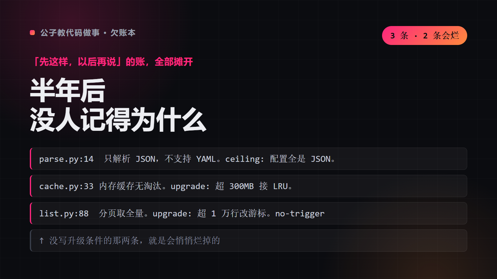

中文 | [English](README.en.md)

# 公子教代码做事 · 欠账本

一个 agent 技能，把代码里所有 `ponytail:` 简化注释收集成一张账本：**简化了什么、上限在哪、什么时候该升级**。

只读不改。它的作用是防止「以后再说」变成「永远不做」。



## 为什么有它

「先这样，以后再说」是工程里最贵的一句话。半年后没人记得当初为什么这么写，也没人知道它什么时候会坏——于是它就一直这样下去。

Ponytail 的约定是：每次故意偷懒，都留一条注释说明上限和升级路径。

```python
# ponytail: 只支持 UTF-8，多编码需求出现时换成 chardet 探测
```

注释是留了，但没人会去翻。这个技能把它们全部捞出来，摊成一张表。

## 它做什么

1. 全仓 grep 注释标记（自动跳过 `node_modules`、`.git`、构建产物）

```bash
grep -rnE '(#|//) ?ponytail:' .
```

2. 每个命中是一行账目，按文件分组
3. 格式：`<文件>:<行>, <简化了什么>. ceiling: <上限>. upgrade: <什么情况该升级>.`
4. 标记出烂账：**没写升级条件**的那几条打 `no-trigger`，这些是最容易悄悄烂掉的

结尾一行 `<N> markers, <M> with no trigger.`。一条都没有：`No ponytail: debt. Clean ledger.`

## 长什么样

```
src/parse.py:14, 只解析 JSON，不支持 YAML. ceiling: 配置文件全是 JSON.
  upgrade: 出现 .yaml 配置时.  no-trigger
src/cache.py:33, 内存缓存，无淘汰. ceiling: 单进程 < 500MB.
  upgrade: 内存超 300MB 时接 LRU.
api/list.py:88, 分页一次取全量. ceiling: 单表 < 10k 行.
  upgrade: 单表超 10k 行时改游标分页.  no-trigger

3 markers, 2 with no trigger.
```

## 安装

```bash
git clone https://github.com/chengangrun-ai/gongzi-teaches-code-debt.git \
  ~/.workbuddy-ai/skills/gongzi-teaches-code-debt
```

没有依赖，不用 pip install。

## 用法

```
/ponytail-debt
```

或者直接问「ponytail 欠了什么」「列出偷懒的地方」「技术债清单」。

想要账本落到文件里（比如 `PONYTAIL-DEBT.md`），明说一句它就会写。

## 边界

- 只读、只报告，不改代码。
- 只认带注释前缀的标记，正文里提到这个约定的文字不会进账本。
- 一次性。想退出：说「正常模式」或 `stop ponytail-debt`。

## 致谢

基于 [Ponytail](https://github.com/DietrichGebert/ponytail)（MIT，作者 DietrichGebert）改写，保留了原作者的版权声明（见 `LICENSE`）。

## License

MIT. See [LICENSE](LICENSE).

Made by [公子](https://github.com/chengangrun-ai).
